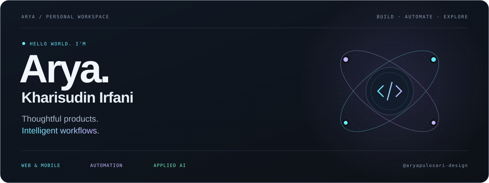
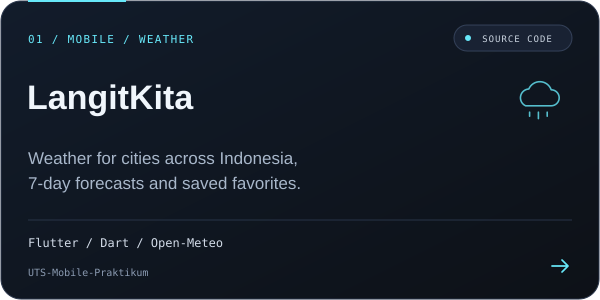
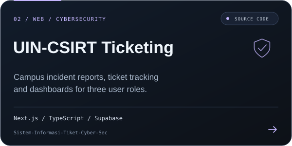
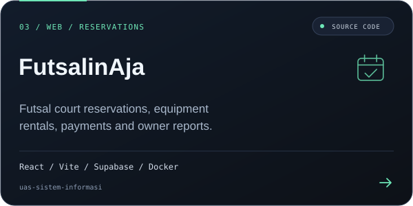
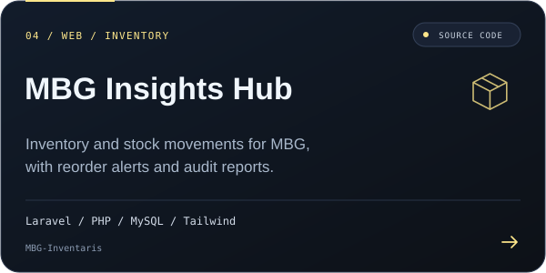
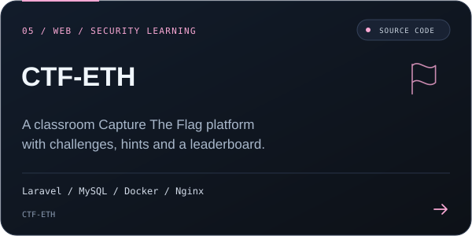
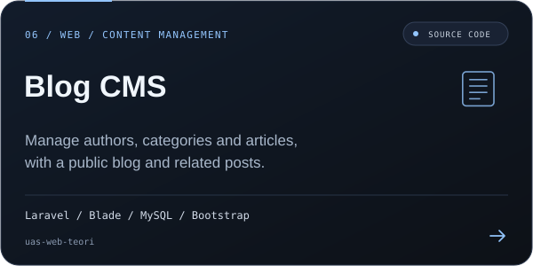
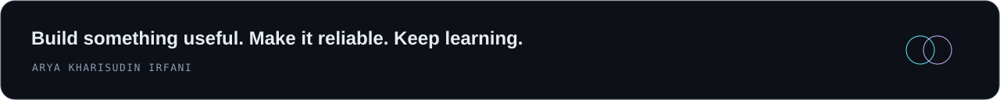

<!-- GitHub profile README for @aryapulosari-design. -->

 

**Thoughtful interfaces. Reliable automation. Practical AI.**

<a href="#about">About</a> &nbsp; / &nbsp;
<a href="#toolbox">Toolbox</a> &nbsp; / &nbsp;
<a href="#projects">Projects</a> &nbsp; / &nbsp;
<a href="#activity">Activity</a> &nbsp; / &nbsp;
<a href="#connect">Connect</a>

  

 

## 01 / A little about me

Hi, I'm **Arya Kharisudin Irfani**. I'm exploring the space where **web and mobile products**, **automation**, and **applied AI** meet.

I want to turn everyday friction into useful software: a clearer interface, a repeatable workflow, or an assistant that makes a task easier to finish.

| What I care about | What I'm exploring |
| :--- | :--- |
| **Build with purpose** — useful products and clear interfaces. | Full-stack web and cross-platform mobile development. |
| **Make it dependable** — repeatable workflows and visible results. | Browser automation, mobile testing, and CI/CD. |
| **Keep people in control** — understandable AI behavior. | LLM tools, retrieval, and workflows with human review. |

 

## 02 / The toolbox

Technologies used across the repositories below.

| Area | Stack |
| :--- | :--- |
| **Web interfaces** |      |
| **Backend & data** |      |
| **Mobile** |   |
| **Development tools** |    |

 

## 03 / Selected projects

Projects and coursework from my public GitHub repositories. Click a card to explore the source code.

<table>
  <tr>
    <td width="50%"></td>
    <td width="50%"></td>
  </tr>
  <tr>
    <td width="50%"></td>
    <td width="50%"></td>
  </tr>
  <tr>
    <td width="50%"></td>
    <td width="50%"></td>
  </tr>
</table>

<b>More projects &amp; coursework</b>

| Repository | What you'll find |
| :--- | :--- |
| **[Si-PAKAR](https://github.com/aryapulosari-design/sipakar)** | A group project for managing class schedules, assignments and study progress, built with PHP, MySQL and Bootstrap. |
| **[Mobile Praktikum 2026](https://github.com/aryapulosari-design/Mobile-Praktikum-2026)** | Mobile programming coursework organized by module. |
| **[Tugas 4 Mobile Programming](https://github.com/aryapulosari-design/Tugas-4-MobilePrograming-Teori)** | A Dart-based mobile programming assignment. |
| **[Tugas 1 Mobile](https://github.com/aryapulosari-design/tugas1-mobil)** | An early mobile programming assignment using Dart. |

**[Explore all my public repositories &#8599;](https://github.com/aryapulosari-design?tab=repositories)**

 

## 04 / Beyond the README

Follow my public work and the ideas taking shape along the way.

**[Browse repositories ↗](https://github.com/aryapulosari-design?tab=repositories)** &nbsp; · &nbsp; **[View contributions ↗](https://github.com/aryapulosari-design?tab=overview)**

<b>GitHub stats & contribution graph</b>

 

  

Stats are served by third-party services and may be temporarily unavailable.

 

## 05 / Let's connect

Interested in web, mobile, automation, or practical AI? Explore my work and follow along.

 

