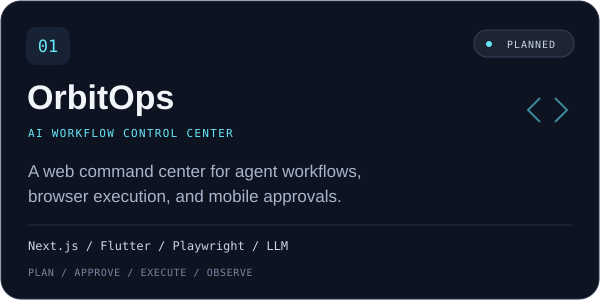
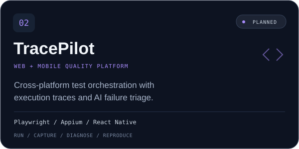
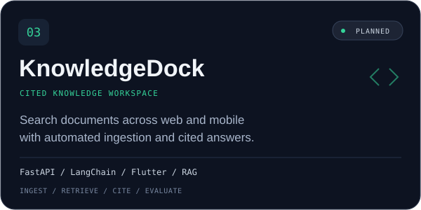
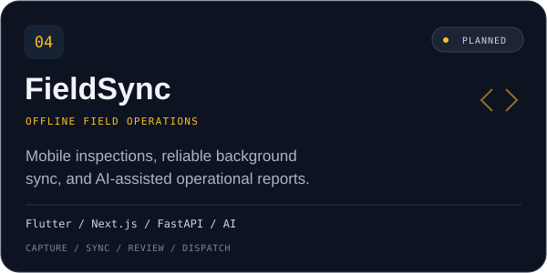

 

**Thoughtful interfaces. Reliable automation. Practical AI.**

<a href="#about">About</a> &nbsp; / &nbsp;
<a href="#toolbox">Toolbox</a> &nbsp; / &nbsp;
<a href="#project-lab">Project lab</a> &nbsp; / &nbsp;
<a href="#activity">Activity</a> &nbsp; / &nbsp;
<a href="#connect">Connect</a>

  

 

## 01 / A little about me

Hi, I'm **Arya Kharisudin Irfani**. I'm exploring the space where **web and mobile products**, **automation**, and **applied AI** meet.

I want to turn everyday friction into useful software: a clearer interface, a repeatable workflow, or an assistant that makes a task easier to finish.

| What I care about | What I'm exploring |
| :--- | :--- |
| **Build with purpose** — useful products and clear interfaces. | Full-stack web and cross-platform mobile development. |
| **Make it dependable** — repeatable workflows and visible results. | Browser automation, mobile testing, and CI/CD. |
| **Keep people in control** — understandable AI behavior. | LLM tools, retrieval, and workflows with human review. |

 

## 02 / The toolbox

My learning roadmap across products, automation, and AI.

| Area | Technologies I'm exploring |
| :--- | :--- |
| **Web** |     |
| **Mobile** |     |
| **Automation** |     |
| **AI & backend** |     |

 

## 03 / Project lab

A small collection of ideas I'd like to bring to life. 
**Concept stage** · These are project plans; implementations and demos are not available yet.

<table>
  <tr>
    <td width="50%"></td>
    <td width="50%"></td>
  </tr>
  <tr>
    <td width="50%"></td>
    <td width="50%"></td>
  </tr>
</table>

<b>Open the notebook — ideas, stacks & engineering focus</b>

### OrbitOps

A web command center for AI workflows, browser workers, and mobile approvals.

**Planned stack:** Next.js · Flutter · FastAPI · Playwright · LLM APIs 
**Focus:** inspectable plans, retries, cancellation, and audit logs.

### TracePilot

A shared view of browser and Android tests, with AI summaries grounded in test artifacts.

**Planned stack:** Next.js · React Native · Playwright · Appium · GitHub Actions 
**Focus:** reproducible tests, traces, and useful failure reports.

### KnowledgeDock

A workspace to capture documents, organize sources, and ask questions with citations.

**Planned stack:** Next.js · Flutter · FastAPI · PostgreSQL / pgvector · LLM APIs 
**Focus:** retrieval quality, source references, access control, and evaluation.

### FieldSync

An offline inspection app connected to a web dashboard, with AI-assisted report drafts.

**Planned stack:** Flutter · Next.js · FastAPI · Local persistence · LLM APIs 
**Focus:** reliable sync, conflict handling, and human review.

 

## 04 / Beyond the README

Follow my public work and the ideas taking shape along the way.

**[Browse repositories ↗](https://github.com/aryapulosari-design?tab=repositories)** &nbsp; · &nbsp; **[View contributions ↗](https://github.com/aryapulosari-design?tab=overview)**

<b>GitHub stats & contribution graph</b>

 

  

Stats are served by third-party services and may be temporarily unavailable.

 

## 05 / Let's connect

Interested in web, mobile, automation, or practical AI? Explore my work and follow along.

 

